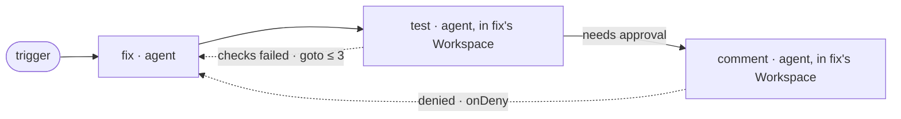

## Author a workflow

You write a workflow file with a person, in a conversation. Here, unlike in a
run, ask the person whatever you cannot find. Each time, produce:

1. **a diagram**, ASCII first and Mermaid below it, drawn from the file;
2. **the file**, in the form this Lyra saves
   (`lyra skills get lyra-workflow --reference definition`);
3. for a file drawn from history, **a found / guessed table**: each step and
   send-back with the sources it came from.

Nothing is saved, turned on or run until the person says so.

## From a description

1. **Ask until you can fill each line**, in the person's words:
   - what starts a run: by hand, or an issue newly assigned to the person on
     a connection (which one, which Jira project or repository), and the
     Lyra Project the steps work in;
   - the steps in order, and who does each: which agent, or which command;
   - what each step must leave: a summary, files, an issue comment, and the
     checks that prove it (a build, a test);
   - where a person must approve before a step starts (often before a step
     that changes something for good, such as a comment), and where a
     denial sends the work back;
   - where a failure goes back (a fix after a failed test), and how often:
     the cap counts every send-back into that step, denials included;
   - for outputs, choice records and checks, what is a must (`required`),
     what is only asked for (`requested`, the default) and what is not
     wanted (`off`), and whether a `floor` keeps every step at `required`
     (a flow that must leave a document at every stage sets one);
   - the time limit.
2. **Map** each line to the fields this Lyra reads (`definition`). A build
   or a test becomes a step's checks or a terminal `agent` step
   (`launch: terminal`); a step that must see an earlier step's changes
   works in that step's Workspace (`where: { workspace: { step: <step> } }`).
   An effort level is a session step's `effort` (a terminal step takes
   none; the step's start refuses an effort its model does not offer). A
   wish it cannot express (a branch on a value, a step only on failure, a
   schedule): say so, offer the nearest shape, and keep the wish as a
   comment in the file.
3. **Write the file and draw it.** Show both and ask what is wrong. Repeat
   until the person agrees.
4. **Before saving**, run `lyra workflow list --json`: saving a name that
   exists makes your file that workflow's next version, which its next run
   uses. Choose a new name unless the person asked to change that workflow
   (`lyra workflow show <workflow> --json` prints its current file).
5. **On the person's word**, `lyra workflow save --file <file> --json`. A new
   workflow is saved turned off. Turning it on (`workflow enable`) makes each
   newly assigned issue start a run without asking: the person's decision,
   as is a first run by hand
   (`lyra workflow run <workflow> --issue <key> --request-id <request-id> --json`).
6. **`workflow.invalid`**: `error.detail.problems` names each problem with
   its path in the file (for example `nodes[1].where`). Fix them and save
   again. A saved file may come back with `warnings` (such as a `layout`
   entry for a step it no longer has): tell the person.

The person may also draw and change the workflow in the Lyra app's workflow
editor, which saves the same file; a file you change keeps the editor's
`layout` (`definition`, "The drawing").

## From a finished project

Draw the workflow the project followed, not the one it planned. Read only;
change nothing. Where the repository is on this computer:

```text
git log --first-parent --merges --format='%h %ad %s' --date=short
git log --format='%h %s' <first-commit>..<merge-commit>
```

| Source | What it shows |
|---|---|
| Merges on the main branch, branch names | the units of work, their order |
| Commit titles (`feat`, `fix`, `test`, `docs`), reverts | the stages; a fix that followed a failure |
| CI files, build scripts, task runners | the commands of build, test and check steps |
| Lyra runs and tasks (`lyra workflow runs --json`, `lyra task list --json`) with their reports | steps, attempts and send-backs as they happened |
| Review and test reports, progress ledgers, decision tables | where a person reviewed or signed off: approvals |

1. **Count; do not guess.** For each stage and send-back, note how often it
   appears and the longest run in a row: a fix after a failed test seen 14
   times, at most 3 in a row, becomes a send-back into the fixing step with
   `max: 3`, which counts every send-back into it. Say what you counted and
   what you left out.
2. **Mark each step and send-back** `found` (with its sources) or `guessed`
   (with why). A step nothing shows is guessed or left out, never shown as
   found.
3. Show the diagram, the table and the file; then go on as from a
   description, step 3.

| Step or send-back | Found in | Seen | Sure |
|---|---|---|---|
| `implement` | merges `a1b2c3d`..`e4f5a6b`, one `feat` commit per issue | 42 | found |
| `test` back to `implement` | a failed CI run, then a `fix` commit on the same branch | 14, at most 3 in a row | found |
| approval before `implement` | design reviews in the reviews folder | 9 of 42 | guessed: most changes had none |

## Draw it

- One box per step: its id, then its kind and agent or command.
- A solid arrow for `after`. A dashed arrow back from the failing step to the
  step its `goto` sends the work to, labelled with the cap (`goto ≤ 3`).
- An approval: a gate mark on the arrow into the step that waits for it,
  labelled `needs approval`, and a dashed arrow from the gate back to its
  `onDeny` step, labelled `denied`.
- A step that works in an earlier step's Workspace: say so in its box.
- A step's checks: list them in its box, `checks: <command>`.
- ASCII in a code block first, then Mermaid in a `mermaid` block:

```text
 trigger ──▶ fix ──▶ test ──╪──▶ comment
              ▲        │      │ needs approval
              │        │      │
              └────────┴──────┘ checks failed: goto ≤ 3 · denied
```



## Keep the person safe

- Bind issue text (`${<trigger>.issue.title}` and the rest) only into a
  prompt or into one argument, never into a command line a shell reads as
  a script: whoever can edit the issue would choose what runs.
- No token or password goes into the file; connections hold them.
- Name what a step changes for good (a comment, a push, a release), and put
  an approval before it when the person wants one.
