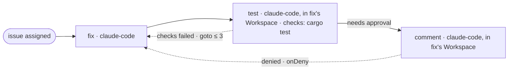

## Example: an issue fixed, tested and answered

An issue assigned to the person starts the run. `fix` changes the code.
`test` works in `fix`'s Workspace: it adds a test for the issue, Lyra runs
the checks, and a failure goes back to `fix`. Before `comment` answers on
the issue, the person approves in `Inbox`; a denial with a note goes back
to `fix` too. At most three send-backs reach `fix` in all.

```text
 issue assigned ──▶ fix ──▶ test ──╪──▶ comment
                     ▲        │    │ needs approval
                     │        │    │
                     └────────┴────┘ checks failed: goto ≤ 3 · denied: onDeny
```



```yaml
lyraWorkflow: 1
name: issue-fix-test
description: Fix an issue assigned to me, test it, send failures back to the fix, and answer on the issue after I approve
orchestrator: lyra
limits: { maxTime: 3h }
policy: { records: requested, checks: required }
nodes:
  - id: assigned
    kind: trigger
    on: signal
    signal: { connection: company-jira, event: issue-assigned, match: { project: ABC } }
    project: billing
  - id: fix
    kind: agent
    after: [assigned]
    agent: claude-code
    where: { workspace: { new: "${assigned.issue.key}" } }
    prompt: |
      Fix ${assigned.issue.key}: ${assigned.issue.title}
      ${assigned.issue.body}
      Commit on this Workspace's branch. On a later attempt, fix what the
      failed test or the person's note says.
    outputs: [ { name: summary, type: text } ]
  - id: test
    kind: agent
    after: [fix]
    agent: claude-code
    where: { workspace: { step: fix } }
    prompt: |
      Test the fix for ${assigned.issue.key} in this Workspace: add a test that fails
      without the fix, run the whole suite, and say what you ran.
      What the fix did: ${fix.summary}
    outputs: [ { name: summary, type: text } ]
    pass:
      checks: [ { run: [cargo, test, --workspace], timeout: 10m } ]
      onFail: { goto: { node: fix, max: 3 } }
  - id: comment
    kind: agent
    after: [test]
    needsApproval: { onDeny: { goto: fix } }
    agent: claude-code
    where: { workspace: { step: fix } }
    prompt: |
      Write the answer for ${assigned.issue.key}: what was wrong, what changed
      and how it was tested.
      The fix: ${fix.summary}
      The test: ${test.summary}
    pass: { comment: true }
```

- **The send-back.** `test` passes when its checks exit 0. On a failure, its
  `onFail` sends the work back to `fix`: `fix` starts its next attempt in
  the same Workspace with a new session, whose first line says "The work
  came back from step `test`", with the end of the check's own output, the
  send-backs left and `test`'s records; then `test` runs again.
- **The approval.** `comment` asks the person before it starts, showing its
  task and what `fix` and `test` left. Approving starts it. Denying needs a
  note; the note goes to `fix` the same way, and `comment` asks again once
  `test` passes again.
- **The cap.** `max: 3` counts every send-back into `fix`, from `test` or
  from the denial. After the third, a failure waits for the person in
  `Inbox`, where one more attempt is one more send-back to `fix`, counted.
- **One Workspace.** `test` and `comment` work in `fix`'s Workspace, so
  `test` tests the fix, and every attempt of each step works there too.
- **Levels.** Records are `requested`, the default. Checks are `required`,
  so a failed test fails the attempt instead of only warning. The two
  summaries are `required` by themselves, because `comment` binds them; so
  is `comment`'s comment.
- **Records.** `fix` records why it chose its fix and, on a later attempt,
  what the failed test showed: a `finding` citing the check the hand-over
  names, such as `check:test#1@2`, which Lyra marks as observed. `test`
  records why its new test covers the issue.
- **One comment.** Only `comment` posts, after the tests pass and the person
  approves: a run that fails before `comment` starts has posted nothing. A
  run can still fail after `comment` posted (its time limit, say), and the
  comment stays. `workflow run-show` gives the comment's link when Lyra saw
  it posted; otherwise a person checks the issue's comments before another
  run posts again.
- **Data, not orders.** The issue's text goes only into prompts; the checks
  are fixed in the file.

## Without a separate test step

Test inside `fix` instead: its checks run in its own Workspace, and a retry
hands the failure back to `fix`'s session while it is open. `comment` then
follows `fix` and binds only `${fix.summary}`.

```yaml
  - id: fix
    kind: agent
    after: [assigned]
    agent: claude-code
    where: { workspace: { new: "${assigned.issue.key}" } }
    prompt: |
      Fix ${assigned.issue.key}: ${assigned.issue.title}
      ${assigned.issue.body}
      Add a test that fails without the fix, and commit on this Workspace's branch.
    outputs: [ { name: summary, type: text } ]
    pass:
      checks: [ { run: [cargo, test, --workspace], timeout: 10m } ]
      onFail: { retry: 3 }
```

Draw it as one box with an arrow back to itself, labelled `retry ≤ 3`.
