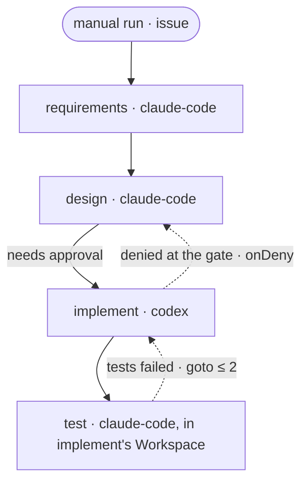

## Example: requirements, design, implementation and test

A change goes through four stages. Each leaves its document as an output
and at least one choice record with evidence, and a person approves the
design before the implementation starts. Outputs, records and checks are
`required`, and a `floor` keeps every stage there: a stage that reports
`completed` without its document or a record fails that attempt, and its
`onFail` decides what next. When no attempt is left, the person decides in
`Inbox`.

```text
 manual run, with an issue
   │
   ▼
 requirements   out/requirements.md + records
   │
   ▼
 design         out/design.md + records      ◀──┐
   │                                            │ denied, with the note:
   ╪  needs approval: the person, in Inbox   ───┘ onDeny goto design
   ▼
 implement      commits + records                 ◀──┐
   │            a failed build: retry ≤ 2            │ tests failed:
   ▼                                                 │ goto ≤ 2
 test           out/test-report.md + records ────────┘
                in implement's Workspace
```



```yaml
lyraWorkflow: 1
name: staged-change
description: Requirements, design, implementation and test for one issue, each with its document and records; I approve the design before implementation
orchestrator: lyra
limits: { maxTime: 8h }
policy: { outputs: required, records: required, checks: required }
floor: { outputs: required, records: required }
nodes:
  - id: start
    kind: trigger
    on: manual
    project: billing
  - id: requirements
    kind: agent
    after: [start]
    agent: claude-code
    where: { workspace: { new: "${start.issue.key}-requirements" } }
    prompt: |
      Write the requirements for ${start.issue.key}: ${start.issue.title}
      ${start.issue.body}
      Put them in out/requirements.md, at most two pages: the goal, what is in
      and out of scope, and acceptance criteria a test can check, numbered.
    outputs:
      - { name: summary, type: text }
      - { name: doc, type: file, path: out/requirements.md }
    pass:
      onFail: { retry: 1 }
  - id: design
    kind: agent
    after: [requirements]
    agent: claude-code
    where: { workspace: { new: "${start.issue.key}-design" } }
    prompt: |
      Design the change for ${start.issue.key} in out/design.md, at most two
      pages: the parts that change and the test that proves each criterion.
      Requirements:
      ${requirements.doc}
    outputs:
      - { name: summary, type: text }
      - { name: doc, type: file, path: out/design.md }
    pass:
      onFail: { retry: 1 }
  - id: implement
    kind: agent
    after: [design]
    needsApproval: { onDeny: { goto: design } }
    agent: codex
    where: { workspace: { new: "${start.issue.key}" } }
    prompt: |
      Implement ${start.issue.key} as designed, and commit on this Workspace's
      branch. Design:
      ${design.doc}
    outputs: [ { name: summary, type: text } ]
    pass:
      checks: [ { run: [cargo, build, --workspace], timeout: 10m } ]
      onFail: { retry: 2 }
  - id: test
    kind: agent
    after: [implement]
    agent: claude-code
    where: { workspace: { step: implement } }
    prompt: |
      Test ${start.issue.key} against each acceptance criterion, and write
      out/test-report.md: each criterion, its test and the result.
      Requirements:
      ${requirements.doc}
    outputs:
      - { name: summary, type: text }
      - { name: report, type: file, path: out/test-report.md }
    pass:
      checks: [ { run: [cargo, test, --workspace], timeout: 10m } ]
      onFail: { goto: { node: implement, max: 2 } }
```

- **Documents as outputs.** Each document is a `file` output: Lyra keeps it
  in the run (`run-output` reads it after the Workspace is gone), and
  binding it pastes it into the next stage's prompt, so keep each document
  short.
- **Required records.** The floor stops any stage from lowering the level.
  Each stage leaves at least one `choice` record with evidence:
  `requirements` how it read the issue, with an `assumption` wherever the
  issue was silent; `design` the choice among the designs it weighed;
  `implement` what it changed and why; `test` which test proves each
  criterion, with the report as `file:` evidence.
- **The approval.** Before `implement` starts, the person sees in `Inbox`
  its task and the documents and records of `requirements` and `design`.
  Approving starts it. Denying needs a note, and sends the work and the
  note back to `design` (`onDeny`); once `design` passes again, `implement`
  asks again in a new round. A failed build retries `implement` itself
  (`onFail`).
- **Tests.** `test` works in `implement`'s Workspace, so it tests what
  `implement` changed. A failed test sends the work back to `implement`, at
  most twice in all; after that, a failure waits for the person in
  `Inbox`, where one more attempt is one more send-back to `implement`.
  A send-back straight to `implement` starts it without asking again: the
  approval covered the design, which did not change.
- **A manual trigger.** Start it on the person's word with
  `lyra workflow run staged-change --issue <key> --request-id <request-id> --json`.
